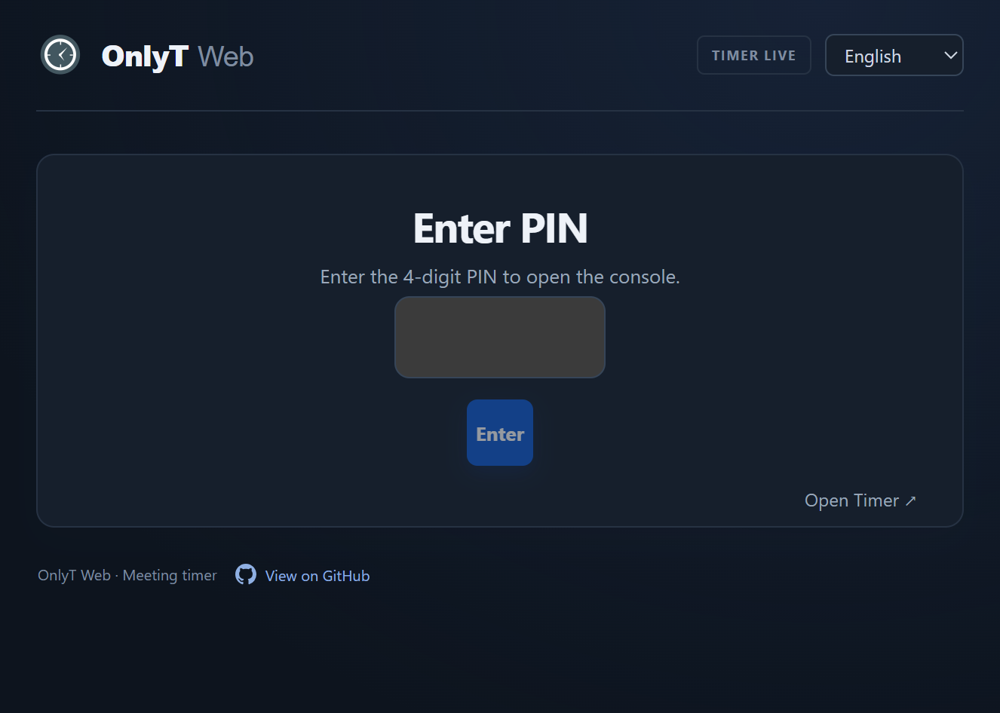
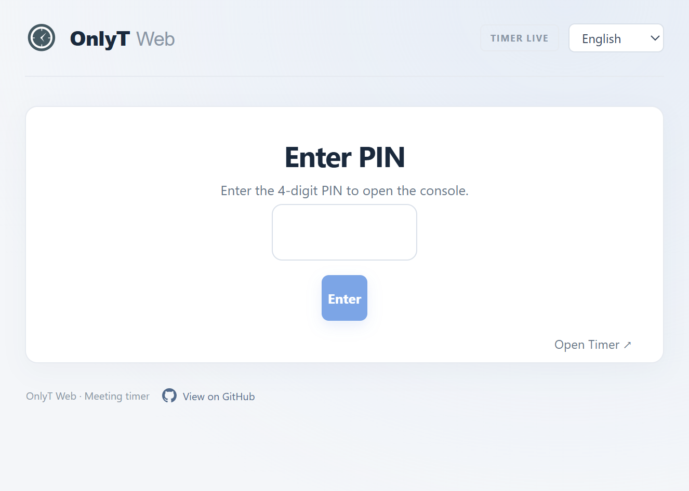
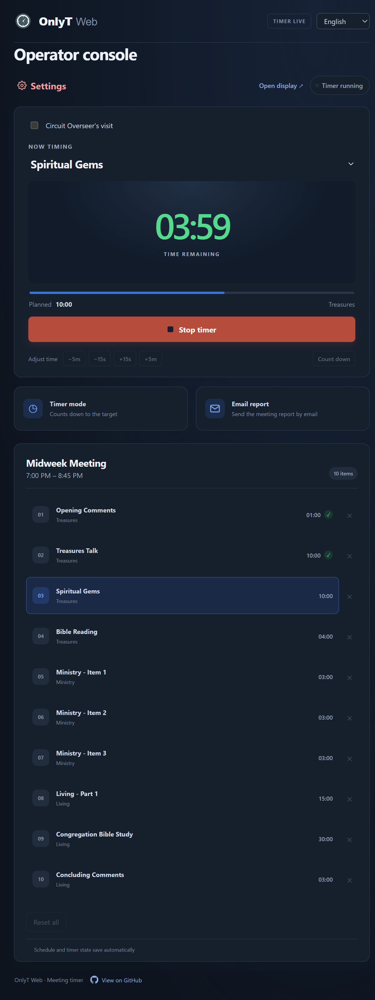
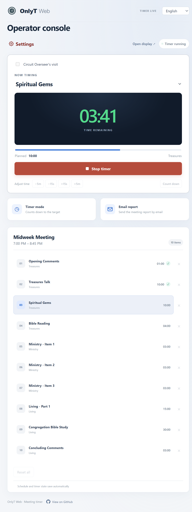
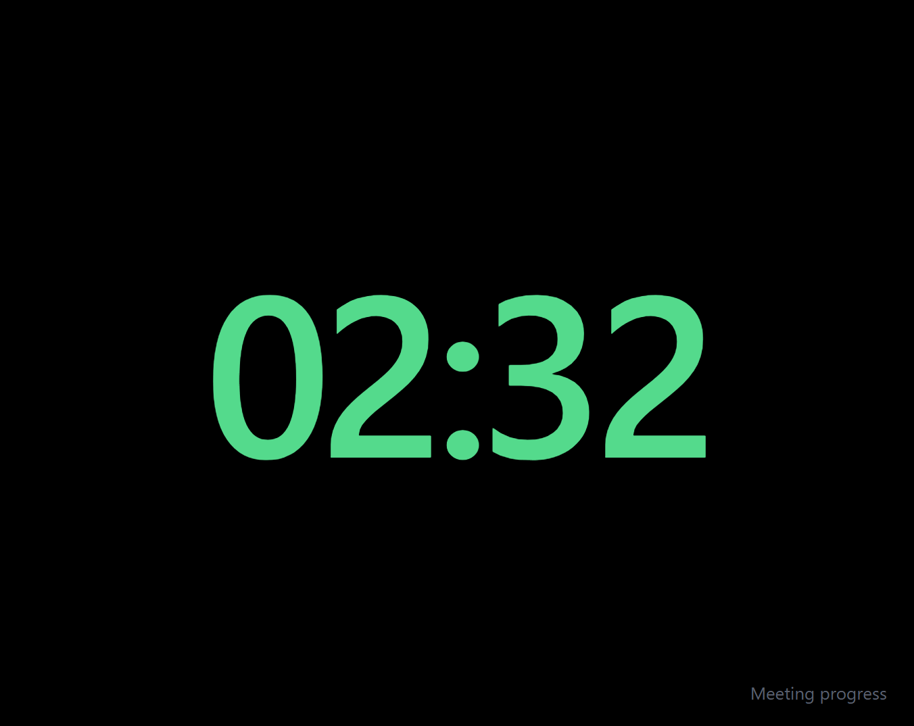
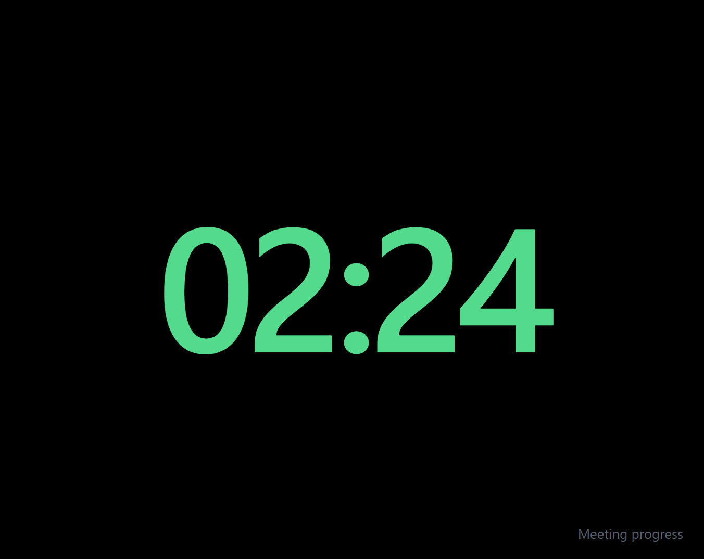
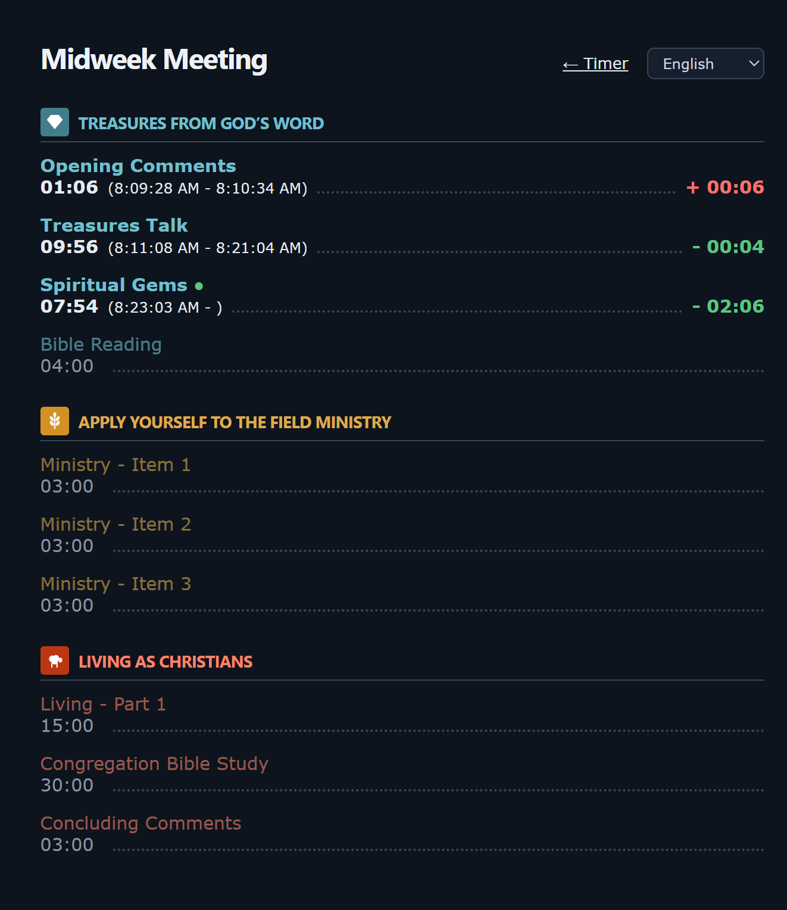
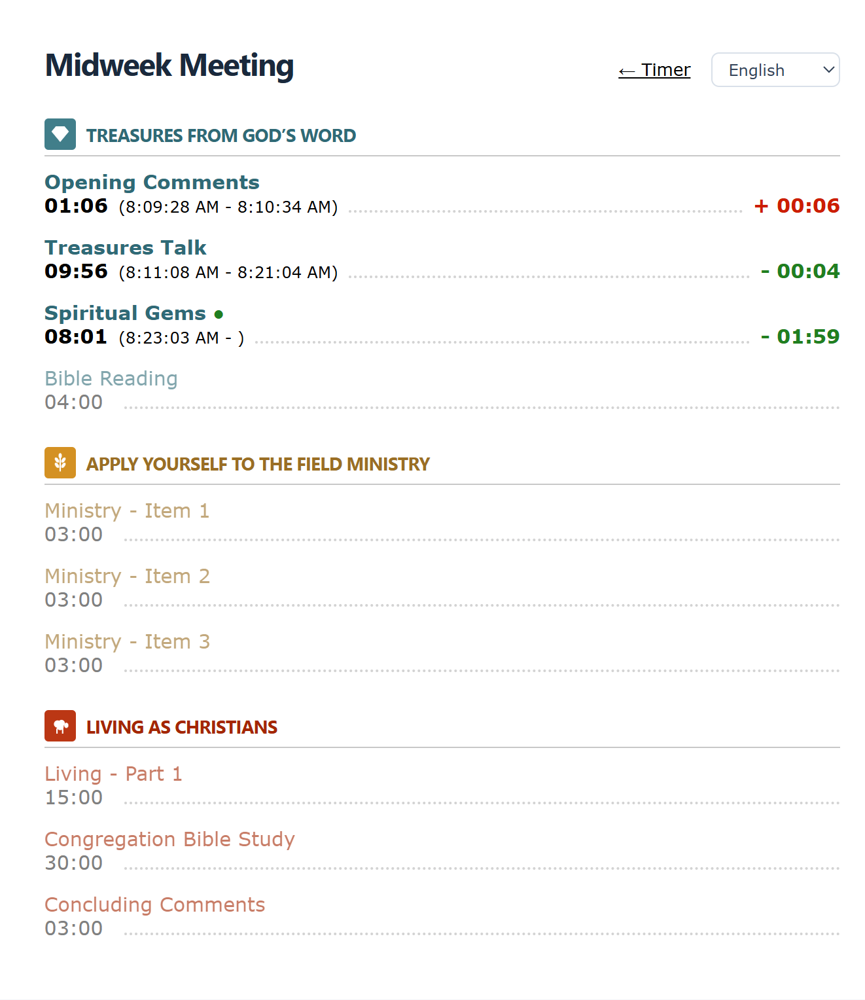

# OnlyT Web

OnlyT Web is a browser-based meeting timer with an Angular operator console and a PHP API. It brings the core OnlyT schedule and timing workflow to a browser, with a separate display for a projector or second screen.

Project home: <https://github.com/DavidIQ/OnlyTWeb>

## Features

- PIN-protected operator console, with a first-run setup to preview and import the mid-week schedule.
- Built-in weekend and mid-week schedules, including Circuit Overseer visit options.
- Start and stop segment timers, choose count-up or count-down, adjust durations, and track progress; schedule and timer state persist in SQLite.
- Configure mid-week and weekend meeting times and the weekend day, and choose no, one-way, or two-way adaptive timing.
- `/display` provides a full-screen clock while idle and a color-coded running timer: green on time, yellow in the final 30 seconds, and red when overtime.
- `/progress` shows completed, running, and upcoming parts, actual start/end times, and early/late variances.
- Email an HTML meeting progress report.
- English, Spanish, Portuguese, French, and Italian UI and schedule translations.
- Installable as a standalone web app. Offline use is not supported.
- The operator console, PIN screen, and progress view follow the device's light or dark appearance. The projector display stays black in either theme.

## Screenshots

| Screen | Dark mode | Light mode |
|---|---|---|
| PIN entry |  |  |
| Operator console |  |  |
| Running timer display |  |  |
| Meeting progress |  |  |

## Requirements

- Node.js and npm
- PHP 8.1+ with PDO SQLite enabled

## Run locally

Start the API in one terminal:

```powershell
php -S 127.0.0.1:8000 -t backend/public backend/public/router.php
```

In another terminal:

```powershell
npm install
npm start
```

Open the Angular URL printed by the CLI (normally `http://localhost:4200`). The Angular development server proxies `/api` requests to the local PHP server.

The first API request creates `backend/storage/onlyt.sqlite` and seeds the built-in weekend schedule; import the mid-week schedule from the setup screen. Schedule entries and settings are stored in SQLite and survive server restarts. Back up this database file to preserve local changes.

## API

The PHP API retains the OnlyT versioned routes and timer response fields:

- `GET /api/` — supported API version range
- `GET /api/v1/timers` and `GET /api/v1/timers/{talkId}` — timer status and schedule
- `POST /api/v1/timers/{talkId}` — start a timer
- `DELETE /api/v1/timers/{talkId}` — stop a timer
- `PUT /api/v1/timers/{talkId}` — update duration or count direction
- `GET /api/v1/schedule/midweek?isCircuitVisit=` — preview the mid-week schedule
- `POST /api/v1/schedule/midweek` — seed the mid-week schedule (`{isCircuitVisit}`); no-op if already present
- `DELETE /api/v1/schedule/talks/{talkId}` — remove a mid-week part (not the last one, not while a timer runs)
- `GET /api/v1/report` — the sender address and saved recipients. `POST /api/v1/report/email` — sends the HTML progress report (`recipients`, `subject`, `html`, `images`) with the sender name `OnlyT Web` and address `MeetingReport@<host>` via PHP `mail()` and, on success, saves the recipients. The HTML is sanitised server-side. Delivery requires a working mail setup on the server (`sendmail_path` or SMTP in `php.ini`); otherwise the API returns `mail_failed`.
- `GET /api/v1/settings`, `PUT /api/v1/settings` — also hold the meeting settings: `circuitVisit`, `midweekStart`/`midweekEnd`, `weekendDay` (0 = Sunday), `weekendStart`/`weekendEnd` (`HH:MM`), `adaptiveMode` (`none`, `oneWay`, `twoWay`). All are stored in SQLite.

The weekend schedule (Public Talk and Watchtower Study) is built in and needs no import. When the Circuit Overseer visits, the Watchtower Study is shortened to 30 minutes and a 30-minute concluding talk is added; on the mid-week meeting the congregation Bible study is replaced by the Circuit Overseer's service talk, after the concluding comments. Part durations can be adjusted for either meeting.
Error responses include a machine-readable `code` used by the client for translated messages.

## Operator console PIN

The operator console is protected by a 4-digit PIN set in `backend/config.php`; change the configured PIN before deploying. `POST /api/v1/auth` (`{pin}`) validates it and sets a 12-hour HttpOnly session cookie; `GET /api/v1/auth` reports the state. Every non-GET API call and the schedule preview require the cookie (401 `auth_required` otherwise). Reads of timers and settings stay public so `/display` and `/progress` work without a PIN. Five wrong attempts lock logins for one minute. Changing the PIN signs everyone out.

## Setup and display

- The meeting settings panel configures mid-week and weekend times, the weekend day, and adaptive timing. The Circuit Overseer option is also available on the main timer screen.
- On first run, when no mid-week schedule is stored, the app offers a schedule preview and import step before opening the console.
- The language picker translates the UI and schedule titles; the selected language is stored in the browser.
- `/display` shows the browser-formatted clock while idle and the running timer otherwise. The clock omits AM/PM, and a link opens `/progress`.
- `/progress` ("Meeting Progress") lists all parts in schedule order. Completed parts show actual durations, start/end times, and early/late variance; the running part updates live and upcoming parts are dimmed. Mid-week parts are grouped under section headings. Both routes require the web server to serve `index.html` for those paths.
- Adaptive timing evaluates schedule offsets when a segment starts. More than 15 seconds ahead or behind (up to 15 minutes) is distributed proportionally across eligible remaining parts; one-way mode shortens parts, while two-way mode may also lengthen them. The configured start time and typical changeover gaps form an approximate planned timeline. The server's PHP time zone is used for the clock.
- `GET /api/v1/system`, `GET /api/v1/datetime`

The timer API adds an `elapsedSeconds` field while retaining the existing property names.

## Publish to a server

The client is static files and the API is PHP, so any Linux host with a web server (nginx or Apache), PHP-FPM 8.1+ and the `pdo_sqlite` and `dom` extensions works. For the email report, configure PHP mail (for example a local Postfix/sendmail) and make sure the host may send mail as `MeetingReport@your-domain`. Use HTTPS: the PIN is sent to the server. The examples serve the app from its own folder, `https://onlyt.example.org/onlyt/` (the folder name is up to you; use it consistently as below).

### Build with generated bundles under `/onlyt/app/`

Run the **Build client for upload** VS Code task, or run:

```powershell
npm run build:upload
```

The upload package is created in `dist/upload`. Its root contains the files to place directly in `/onlyt/` (`index.html`, public assets, and the `app/` bundle directory), alongside a separate `backend/` directory. Copy the root files and `app/` to the directory served at `/onlyt/`. Copy `backend/` outside the web root (for example to `/var/www/onlyt/backend`) so its PHP source and configuration cannot be downloaded. The build uses `/onlyt/` as the application base path and `/onlyt/app/` for generated bundle URLs. Copy `backend/config.example.php` to `backend/config.php` and set a new PIN before deployment. Configure the web server to route `/onlyt/api` to `backend/public/index.php`. The package excludes local storage data; PHP must be able to create and write `backend/storage`. The subfolder-only deployment described below is an alternative layout and uses its own build command.

1. **Configure.** Set a new PIN in `backend/config.php`. Set the PHP time zone to the congregation's local time (`date.timezone = America/New_York` in `php.ini` or the pool config), because adaptive mode compares the meeting start time with the server clock.
2. **Build the client** on your computer:

   ```powershell
   npm install
   npm run build -- --base-href /onlyt/
   ```

   The static site is created in `dist/onlyt-web/browser`. The `--base-href` value must match the folder the app is served from (use `/` for the domain root).
3. **Upload** to a layout like this, keeping `backend` outside the web root so `config.php` and the database can't be downloaded:

   ```text
   /var/www/onlyt/
     web/       <- contents of dist/onlyt-web/browser (served at /onlyt/)
     backend/   <- the backend folder (public/, src/, storage/, config.php)
   ```

4. **Permissions.** PHP-FPM's user must be able to write `backend/storage` (it holds `onlyt.sqlite` and `auth_attempts.json`, created on the first request):

   ```bash
   sudo chown -R www-data:www-data /var/www/onlyt/backend/storage
   sudo chmod 770 /var/www/onlyt/backend/storage
   ```

5. **Web server.** Serve the static site, send `/onlyt/api` to `backend/public/index.php`, and fall back to `index.html` for every other path under `/onlyt/` so `/onlyt/display` and `/onlyt/progress` work when opened directly.

   nginx (adjust the server name, certificate and PHP-FPM socket):

   ```nginx
   server {
       listen 443 ssl;
       server_name onlyt.example.org;
       # ssl_certificate / ssl_certificate_key ...

       location /onlyt/api {
           include fastcgi_params;
           fastcgi_param SCRIPT_FILENAME /var/www/onlyt/backend/public/index.php;
           fastcgi_pass unix:/run/php/php8.3-fpm.sock;
       }

       location /onlyt/ {
           alias /var/www/onlyt/web/;
           index index.html;
           try_files $uri /onlyt/index.html;
       }
   }
   ```

   Apache (with `mod_rewrite`, `mod_proxy_fcgi` and `mod_alias`; adjust the socket):

   ```apache
   <VirtualHost *:443>
       ServerName onlyt.example.org
       # SSLEngine on, SSLCertificateFile ...

       Alias /onlyt/api /var/www/onlyt/backend/public/index.php
       Alias /onlyt /var/www/onlyt/web
       <Directory /var/www/onlyt/web>
           Require all granted
           RewriteEngine On
           RewriteBase /onlyt/
           RewriteCond %{REQUEST_FILENAME} !-f
           RewriteRule ^ /onlyt/index.html [L]
       </Directory>

       <Directory /var/www/onlyt/backend/public>
           Require all granted
           <FilesMatch "\.php$">
               SetHandler "proxy:unix:/run/php/php8.3-fpm.sock|fcgi://localhost"
           </FilesMatch>
       </Directory>
   </VirtualHost>
   ```

   Apache with `.htaccess` only (shared hosting, where you can't edit the virtual host or use `Alias`). Everything lives in one folder inside the web root, here `public_html/onlyt/`, served at `https://example.org/onlyt/`. This needs `mod_rewrite` and `AllowOverride` enabled for `.htaccess`. Use this layout instead of the one in step 3 (the build command is the same as in step 2):

   ```text
   public_html/onlyt/
     index.html, main-*.js, ...   <- contents of dist/onlyt-web/browser
     .htaccess                    <- rules below
     api.php                      <- entry point below
     backend/                     <- the backend folder (public/, src/, storage/, config.php)
       .htaccess                  <- blocks direct access
   ```

   1. Build with the folder as the base path (use your own folder name):

      ```powershell
      npm run build -- --base-href /onlyt/
      ```

   2. Create `onlyt/api.php`, a small entry point that loads the real one:

      ```php
      <?php
      require __DIR__ . '/backend/public/index.php';
      ```

   3. Create `onlyt/.htaccess` (change `/onlyt/` if you use another folder name):

      ```apache
      RewriteEngine On
      RewriteBase /onlyt/

      # Force HTTPS (the PIN is sent to the server)
      RewriteCond %{HTTPS} off
      RewriteRule ^ https://%{HTTP_HOST}%{REQUEST_URI} [L,R=301]

      # Send the API to the PHP entry point
      RewriteRule ^api(/.*)?$ api.php [L]

      # Serve real files as-is, and fall back to index.html so /onlyt/display and /onlyt/progress work when opened directly
      RewriteCond %{REQUEST_FILENAME} !-f
      RewriteCond %{REQUEST_FILENAME} !-d
      RewriteRule ^ index.html [L]
      ```

   4. Create `onlyt/backend/.htaccess` so the PIN and the database can't be downloaded:

      ```apache
      Require all denied
      ```

      Check that `https://example.org/onlyt/backend/config.php` and `https://example.org/onlyt/backend/storage/onlyt.sqlite` return 403.

   The app and API use paths relative to the folder, so the same build works under any folder name as long as it is built with the matching `--base-href`.
6. **Check it.** Open `https://onlyt.example.org/onlyt/api/` (it should return `{"lowVersion":1,"highVersion":4}`), then `https://onlyt.example.org/onlyt/`, which asks for the PIN. Open `/onlyt/display` on the projector or second screen. (In the `.htaccess` setup the host is `https://example.org` instead.)

**Updating.** Rebuild, then replace the contents of `web/` and the `backend/public` and `backend/src` folders. Don't overwrite `backend/storage` (your schedule, settings and timings) or `backend/config.php` (your PIN). Database changes are applied automatically on the next request. To back up, copy `backend/storage/onlyt.sqlite`.

## Port scope

The port covers the schedule/operator timer and browser display. WPF window placement, NDI output, adaptive-meeting feeds, desktop notifications, and the original LiteDB timing reports are Windows desktop features and are not implemented in this web version.

For development, bind PHP to `127.0.0.1` as shown above. Before exposing the app on a network, follow [Publish to a server](#publish-to-a-server): use HTTPS and change the default PIN.

## Credits

OnlyT Web is based on [OnlyT](https://github.com/AntonyCorbett/OnlyT), the Windows meeting timer created by Antony Corbett and released under the MIT license. The original copyright notice is kept in [LICENSE](LICENSE). Thank you, Antony, for the original app.
